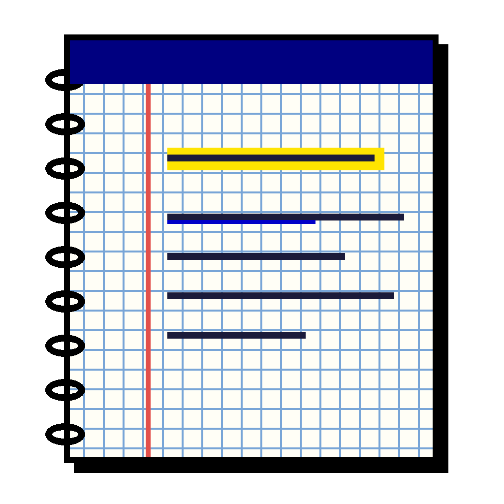
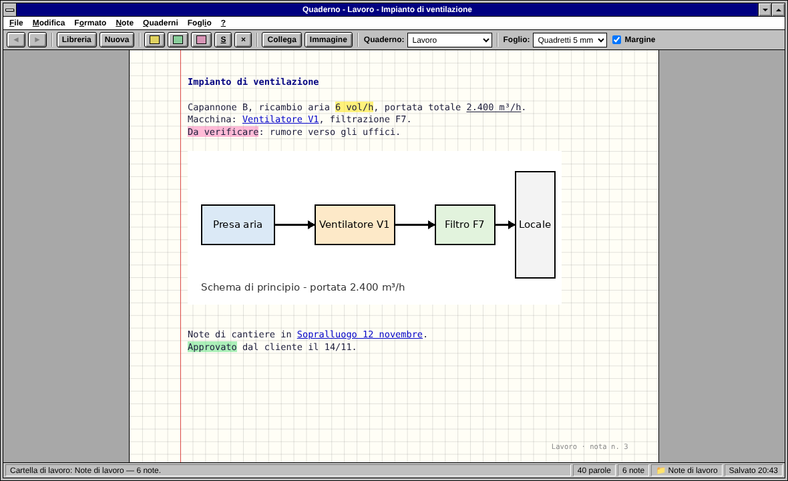
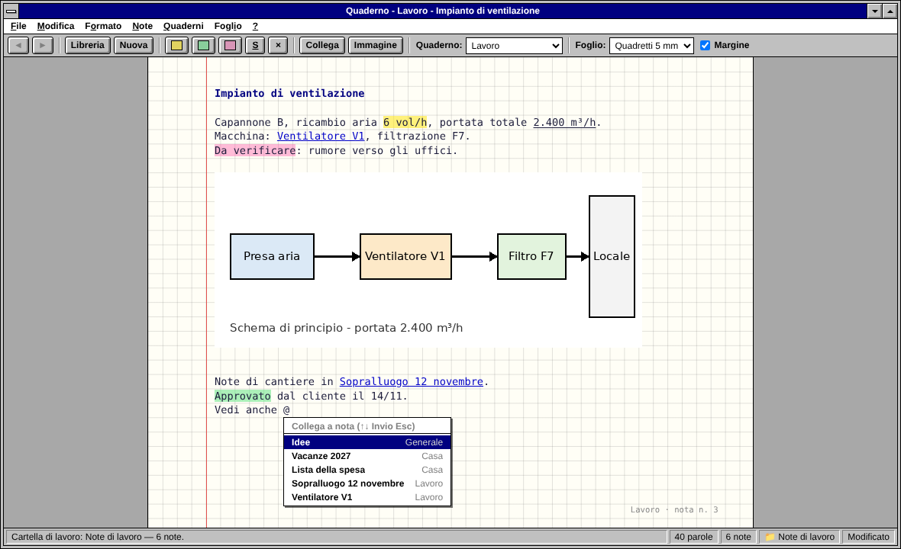
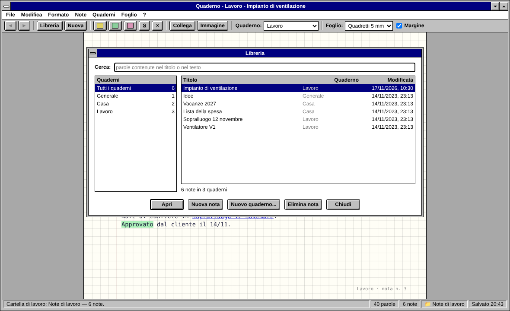
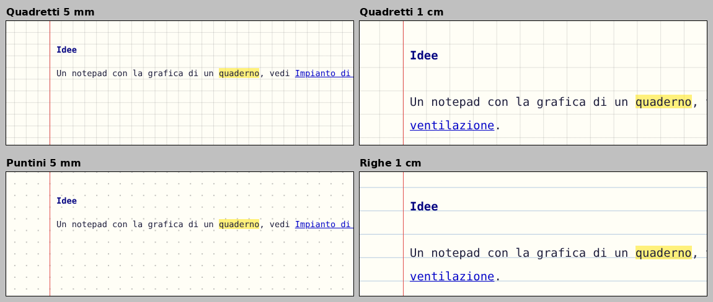

<div align="center">



# Quaderno

**Un blocco note con la carta del quaderno di scuola, i menu di Windows 3.1 e i collegamenti tra note di Tomboy.**
Le note sono semplici file Markdown in una cartella tua.

[](https://github.com/parrel85/quaderno/releases/latest)
[](https://parrel85.github.io/quaderno/)
[](LICENSE)



</div>

## Cosa fa

- **Carta da quaderno**: quadretti 5 mm, quadretti 1 cm, puntini 5 mm, righe 1 cm, con o senza margine rosso. Il testo è allineato alla griglia.
- **Un solo font**, Consolas, e **tre evidenziatori** (giallo, verde, rosa) più il sottolineato.
- **Collegamenti tra note come in Tomboy**:
  - selezioni una parola e premi `Ctrl+L`: se la nota esiste si riapre, altrimenti nasce;
  - scrivi il titolo di una nota esistente e diventa un link da solo;
  - scrivi `@` per scegliere la nota da un menu a tendina;
  - se rinomini una nota, i link nelle altre si aggiornano.
- **Quaderni**: le note sono divise in quaderni, ma i collegamenti valgono tra tutti.
- **Immagini**: le incolli, le trascini sul foglio o le inserisci da menu. Si ridimensionano al 25/50/100%.
- **I tuoi file, in chiaro**: una nota è un file `.md`, un quaderno è una cartella. Si aprono anche con Obsidian, VS Code o il Blocco note.
- Ricarica automatica se un file cambia da fuori (OneDrive, un altro PC), con avviso in caso di conflitto. Le note eliminate vanno in un cestino.
- In fondo al foglio, il **quaderno e il numero progressivo** della nota. Si stampa **con il foglio o su pagina bianca**.
- Import delle vecchie note **Tomboy / Gnote** (`.note`).

<table>
<tr>
<td></td>
<td></td>
</tr>
<tr>
<td align="center">Scrivi <code>@</code> e scegli la nota da collegare</td>
<td align="center">La libreria, con i quaderni a sinistra</td>
</tr>
</table>



## Scaricare e installare

Dalla pagina [**Releases**](https://github.com/parrel85/quaderno/releases/latest):

| Sistema | File |
|---|---|
| Windows (con installazione) | `Quaderno-x.y.z-setup.exe` |
| Windows (senza installazione, anche da chiavetta) | `Quaderno-x.y.z-portable.exe` |
| Mac con chip Apple (M1, M2, …) | `Quaderno-x.y.z-mac-arm64.dmg` |
| Mac Intel | `Quaderno-x.y.z-mac-x64.dmg` |

L'app non è firmata digitalmente:
- **Windows**: se compare SmartScreen, clicca *Ulteriori informazioni* → *Esegui comunque*.
- **Mac**: la prima volta apri l'app con clic destro → *Apri*. Se dice che è "danneggiata", da Terminale: `xattr -cr /Applications/Quaderno.app`.

C'è anche la **[versione browser](https://parrel85.github.io/quaderno/)**, da usare con Chrome o Edge. Di base salva le note nel browser. Con *File → Cartella di lavoro* può usare la stessa cartella dell'app desktop.

## La cartella di lavoro

Al primo avvio l'app propone `Documenti/Quaderno`. Si cambia da *File → Cartella di lavoro…*.

```
Quaderno/                          ← cartella di lavoro
├── Idee.md                        ← note del quaderno "Generale"
├── allegati/                      ← immagini delle note di "Generale"
├── Lavoro/                        ← un quaderno = una sottocartella
│   ├── Impianto di ventilazione.md
│   ├── Ventilatore V1.md
│   └── allegati/schema.png
├── Casa/
│   └── Lista della spesa.md
└── _cestino/                      ← note e quaderni eliminati
```

Una nota vista dentro:

```markdown
---
id: n1a2b3c
numero: 7
creata: 2026-11-10T09:00:00
modificata: 2026-11-17T10:30:00
---
# Impianto di ventilazione
Ricambio aria ==6 vol/h==, portata <u>2.400 m³/h</u>.
Macchina: [[Ventilatore V1]].
<mark class="rosa">Da verificare</mark>, <mark class="verde">approvato</mark>

```

| In Quaderno | Nel file `.md` |
|---|---|
| collegamento | `[[Titolo della nota]]` (come in Obsidian) |
| evidenziatore giallo | `==testo==` |
| evidenziatore verde / rosa | `<mark class="verde">…</mark>` / `<mark class="rosa">…</mark>` |
| sottolineato | `<u>…</u>` |
| immagine | ``, oppure `` se ridimensionata |

Note utili:
- il titolo è la prima riga della nota e dà il nome al file. Deve essere unico in tutta la cartella, perché i link valgono tra tutti i quaderni;
- viene letto un solo livello di sottocartelle. Le cartelle che iniziano con `_` o `.` e quelle chiamate `allegati` vengono ignorate;
- se la cartella è condivisa (OneDrive, disco di rete) e due persone modificano la stessa nota insieme, Quaderno chiede quale versione tenere.

## Scorciatoie

| Tasti | Azione |
|---|---|
| `Ctrl+N` | nuova nota |
| `Ctrl+O` | libreria |
| `Ctrl+L` / `Ctrl+Shift+L` | collega la selezione / togli il collegamento |
| `@` | menu per collegare una nota |
| `Ctrl+1` `Ctrl+2` `Ctrl+3` | evidenziatore giallo, verde, rosa |
| `Ctrl+U` / `Ctrl+0` | sottolinea / togli la formattazione |
| `Ctrl+F`, `F3` | trova, trova successivo |
| `Alt+←` / `Alt+→` | nota precedente / successiva |
| `Ctrl+P` | stampa sul foglio scelto |
| `Alt+lettera` | apre il menu con quella lettera sottolineata |

Su Mac al posto di `Ctrl` si usa `⌘`.

## Sviluppo e creazione dell'app

È un'app [Electron](https://www.electronjs.org/) (Electron 45, electron-builder 26). Tutta l'interfaccia sta in `app/index.html`, che funziona anche da sola nel browser.

```bash
npm install
npm start            # avvia l'app
npm run dist:mac     # .dmg per Mac con chip Apple e Intel
npm run dist:win     # setup.exe e portable.exe per Windows (anche dal Mac)
npm run dist:all     # entrambi
```

Su Mac ci sono anche gli script da avviare con doppio clic nella cartella `strumenti-mac/`. La guida completa, con i problemi più comuni, è in **[docs/COMPILARE.md](docs/COMPILARE.md)**. Per la pubblicazione su GitHub: **[docs/PUBBLICARE.md](docs/PUBBLICARE.md)**.

Il font Consolas è di Microsoft e non è incluso. Su Mac, se manca (c'è solo con Office), si usa Menlo.

## Licenza

[MIT](LICENSE). Ispirato a [Tomboy](https://wiki.gnome.org/Apps/Tomboy) e a Windows 3.1. Non è affiliato a nessuno dei due.
